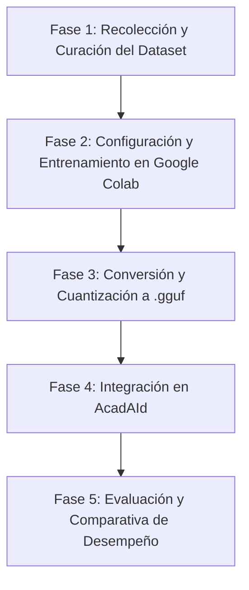

# 📋 Plan de Implementación Futura: Fine-Tuning de Modelo IA Local para AcadAId

Este documento detalla la hoja de ruta y los pasos técnicos requeridos para entrenar un modelo personalizado (Fine-Tuning con QLoRA) en **Google Colab** e integrarlo en la arquitectura RAG local de **AcadAId**.

---

## 🎯 Objetivo
Adaptar el comportamiento, estilo de redacción, formato de respuesta y rigor académico del modelo de lenguaje (`Qwen 2.5 3B / Llama 3.2 3B`) a los estándares requeridos para investigación y publicación de papers científicos, sin perder la privacidad ni la ejecución 100% offline.

---

## 🗺️ Fases del Plan



---

### 📂 Fase 1: Recolección y Curación del Dataset

Para que el modelo aprenda a redactar como un investigador académico, se debe construir un conjunto de datos en formato ChatML (`dataset.jsonl`).

1. **Definición del Formato (`train_dataset.jsonl`):**
   ```json
   {
     "messages": [
       {"role": "system", "content": "Eres un asistente de investigación académica especializado en sintesis de papers..."},
       {"role": "user", "content": "Sintetiza la metodología empleada en este extracto..."},
       {"role": "assistant", "content": "## Metodología y Enfoque\nSe aplicó un diseño experimental cuantitativo...\n\n### Citas Directas:\n> 'Extracto clave del paper...'"}
     ]
   }
   ```
2. **Volumen de Datos Recomendado:**
   - **Mínimo:** 50 a 100 parejas de instrucción/respuesta de alta calidad.
   - **Ideal:** 300 a 500 ejemplos curados.

---

### 🧪 Fase 2: Entrenamiento en Google Colab (QLoRA con Unsloth)

Utilizaremos la librería **`Unsloth`** por su alta eficiencia (2x más rápido y usa 80% menos memoria VRAM).

1. **Entorno de Ejecución:**
   - Servidor gratuito de Google Colab con GPU **NVIDIA T4 (15 GB VRAM)**.
2. **Librerías a Instalar en Colab:**
   ```bash
   pip install "unsloth[colab-new] @ git+https://github.com/unslothai/unsloth.git"
   pip install --no-deps xformers "trl<0.9.0" peft accelerate bitsandbytes
   ```
3. **Parámetros de Entrenamiento QLoRA:**
   - **Modelo Base:** `Qwen/Qwen2.5-3B-Instruct-bnb-4bit`
   - **r (Rank):** 16
   - **lora_alpha:** 16
   - **Epochs / Steps:** 2 a 3 épocas (aprox. 300 - 500 pasos).
   - **Learning Rate:** `2e-4`
   - **Tiempo estimado:** ~20 a 30 minutos en la GPU T4 de Colab.

---

### 🔄 Fase 3: Conversión y Cuantización a formato `.gguf`

Una vez finalizado el ajuste fino en Colab, convertiremos los pesos del modelo para que sean compatibles con el motor C++ local `llama-cpp-python`.

1. **Exportar desde Unsloth:**
   Unsloth incluye comandos nativos para exportar a `.gguf` directamente desde el notebook:
   ```python
   # Exportar a formato GGUF con cuantización Q4_K_M
   model.save_pretrained_gguf(
       "qwen2.5-3b-academic-custom",
       tokenizer,
       quantization_method="q4_k_m"
   )
   ```
2. **Descarga del Archivo:**
   - Guardar el archivo resultante `qwen2.5-3b-academic-custom-Q4_K_M.gguf` (~2.2 GB) en Google Drive o descargarlo localmente.

---

### 🚀 Fase 4: Integración Local en AcadAId

1. **Ubicación del Nuevo Modelo:**
   Copiar el archivo descargado en la carpeta de modelos del proyecto:
   `h:\AcadAId\models\qwen2.5-3b-academic-custom-Q4_K_M.gguf`

2. **Actualización de la Configuración en [`download_model.py`](file:///h:/AcadAId/download_model.py) / [`rag_engine.py`](file:///h:/AcadAId/rag_engine.py):**
   Modificar la constante `MODEL_FILE`:
   ```python
   MODEL_FILE = "qwen2.5-3b-academic-custom-Q4_K_M.gguf"
   ```

---

### 📊 Fase 5: Validación y Comparativa

1. **Pruebas A/B en la Interfaz de Streamlit:**
   - Realizar la misma consulta en un proyecto de prueba utilizando el modelo base vs. el modelo entrenado.
2. **Criterios de Éxito:**
   - Cero repeticiones de frases.
   - Respeto del formato académico (títulos, subtítulos y citas textuales).
   - Generación fluida en español adaptada al léxico científico.

---

> [!NOTE]
> Este documento queda guardado en la memoria y archivos del proyecto para ser consultado e implementado en el momento que decidas iniciar la etapa de Fine-Tuning.
